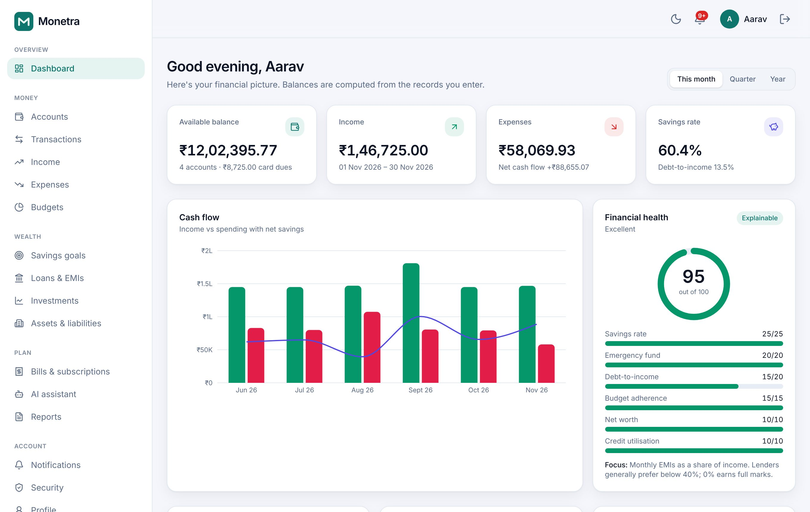
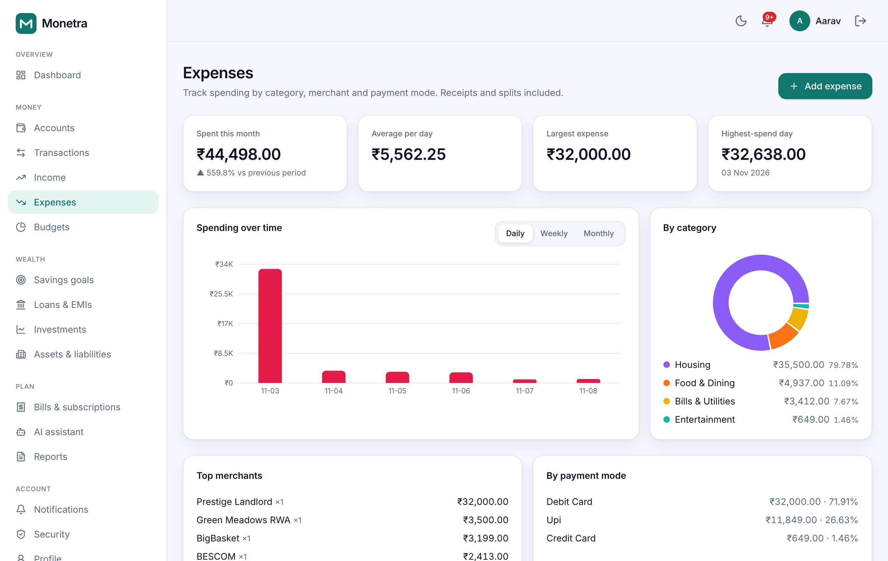
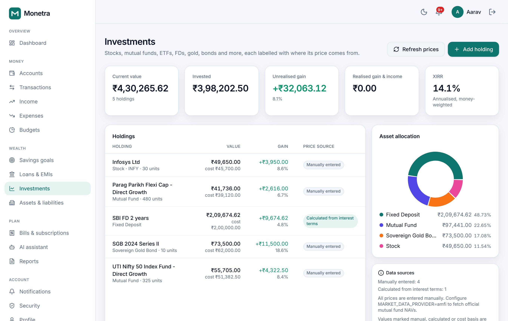
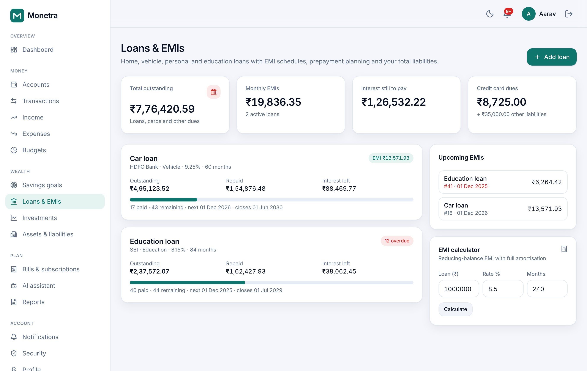
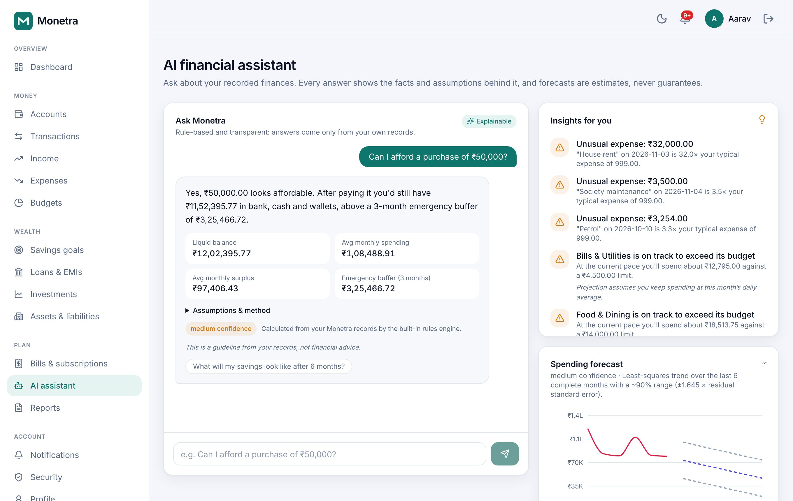
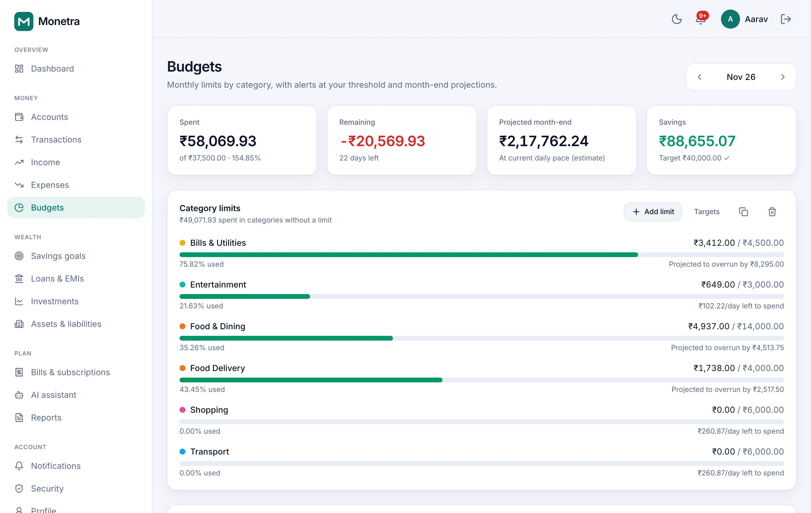
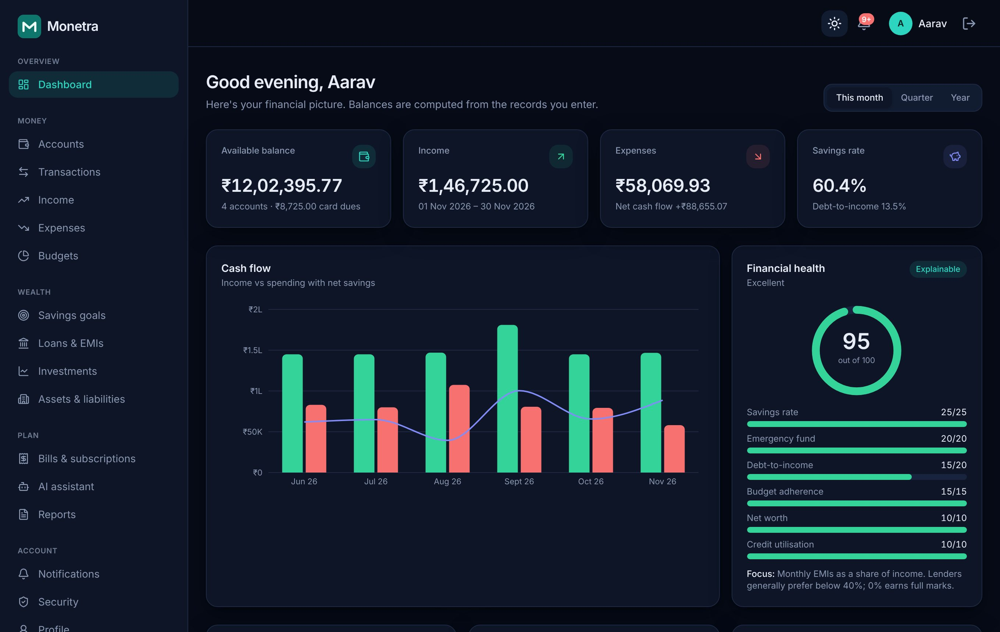

# PROJECT MONETRA

**Unified Financial Intelligence & Money Management Ecosystem**

Monetra is a full-stack personal finance platform. It brings income, spending,
bank accounts, UPI, budgets, loans and EMIs, investments, savings goals, bills,
net worth and tax records into one financial command centre. It is built for
Indian households first (INR, UPI, EMI, TDS, financial year April–March), and
the design can expand to other countries later.



| | |
| --- | --- |
|  |  |
|  |  |
|  |  |

## Highlights

- **Immutable double-checked ledger.** Every money movement is a ledger entry
  stored as `NUMERIC(19,4)`, so balances never pass through floating point.
  Database triggers make financial fields immutable. You fix mistakes by
  posting a reversal or correction, and the full history stays.
- **Every module works end to end.** Accounts, transactions, UPI, income (with
  TDS), expenses (with receipts and splits), recurring schedules, budgets,
  goals, loans (with amortisation and prepayment), investments (average cost,
  XIRR), assets, liabilities, bills, subscriptions, notifications and reports
  each have UI, API, persistence, validation and tests.
- **Explainable AI assistant.** It answers questions like *"Where did my money
  go this month?"* or *"Can I afford ₹50,000?"* from your own records only. It
  shows the facts, the assumptions and a confidence level. Forecasts always
  come with a range and a disclaimer.
- **Security first.** scrypt password hashing, TOTP two-factor sign-in with
  recovery codes, refresh-token rotation with reuse detection, server-side
  session revocation, CSRF and rate-limit protection, AES-256-GCM field
  encryption, content-sniffed uploads, an append-only audit log, data export
  and account deletion.
- **Honest data.** Monetra never pretends to be connected to a bank. Every
  investment price is labelled *live*, *delayed* (for example official AMFI
  end-of-day NAVs), *manual*, *calculated* or *simulated*.
- **Reports.** Monthly and annual statements, income vs expenditure, account
  statements, tax summary, loan and investment reports, and net worth. Export
  to **PDF, Excel and CSV**.

## Tech stack

| Layer | Technology |
| --- | --- |
| Frontend | Next.js 15 (App Router), React 19, TypeScript, Tailwind CSS 4, Recharts, SWR |
| Backend | Node.js 22, Express 5, TypeScript, zod, Knex, pino |
| Data | PostgreSQL 16 (primary store), Redis 7 (rate limits, cache, BullMQ queues) |
| Jobs | BullMQ worker, or an in-process scheduler guarded by a Postgres advisory lock |
| Reports | pdfkit, exceljs |
| Infra | Docker, Docker Compose, Nginx, GitHub Actions |
| Tests | Vitest + Supertest (186 unit and integration tests on a real PostgreSQL), Playwright end-to-end |

## Quick start (Docker)

```bash
cp .env.example .env
```

Fill in `JWT_ACCESS_SECRET`, `HASH_PEPPER` and `DATA_ENCRYPTION_KEY` in `.env`
(the file explains how to generate each one). Then start the stack:

```bash
docker compose up --build -d
```

Optionally load the demo workspace:

```bash
docker compose exec api node dist/db/seed.js
```

- App: <http://localhost:8080>
- API docs (Swagger UI): <http://localhost:8080/api/docs>
- Emails sent by the app (Mailpit): <http://localhost:8025>
- Demo login: `demo@monetra.app` / `Demo#Monetra2026`

## Local development (Windows, macOS, Linux)

You need Node.js 22+, PostgreSQL 16 and (optionally) Redis 7.

```bash
npm run install:all
```

```bash
cp backend/.env.example backend/.env
```

```bash
npm run migrate
```

```bash
npm run seed
```

Run the API and the web app in two terminals:

```bash
npm run dev:backend
```

```bash
npm run dev:frontend
```

Open <http://localhost:3000>. The Next.js dev server proxies `/api` to the
backend on port 4000, so cookies stay same-origin. On Windows, run the same
commands in PowerShell. Backups use `infra/backup/backup.ps1`.

## Testing

```bash
npm test
```

This runs the backend unit and integration tests. It needs a PostgreSQL test
database; set `TEST_DATABASE_URL`.

```bash
npm run test:e2e
```

This runs the Playwright tests against a running stack on
`http://localhost:3000`, or on `E2E_BASE_URL` if you set it.

CI (`.github/workflows/ci.yml`) runs type checks, the full test suite on
PostgreSQL, dependency audits, the end-to-end suite and the Docker image builds.

## Repository layout

```
backend/            Express API (modules/, engine/, jobs/, db/migrations, tests/)
frontend/           Next.js web app (app/, components/, lib/)
e2e/                Playwright end-to-end tests
infra/nginx/        Reverse proxy configs (HTTP and TLS)
infra/backup/       Backup and restore scripts (sh + PowerShell)
docs/               Architecture, API, calculations, deployment, security, user guide
```

## Documentation

- [Architecture](docs/ARCHITECTURE.md)
- [API guide](docs/API.md) and the generated [OpenAPI spec](docs/openapi.json)
- [Financial calculation engine](docs/CALCULATIONS.md)
- [Deployment & operations](docs/DEPLOYMENT.md)
- [Security](docs/SECURITY.md)
- [User manual](docs/USER_GUIDE.md)

## Important notes

- Monetra is a record-keeping and analysis tool. It does **not** move money,
  connect to banks or process payments. It never asks for bank passwords, UPI
  PINs, card CVVs, full card numbers or OTPs.
- Insights, health scores and forecasts are educational estimates based on
  your records. They are not financial, tax or investment advice.

## License

[MIT](LICENSE) © kryptonite012
